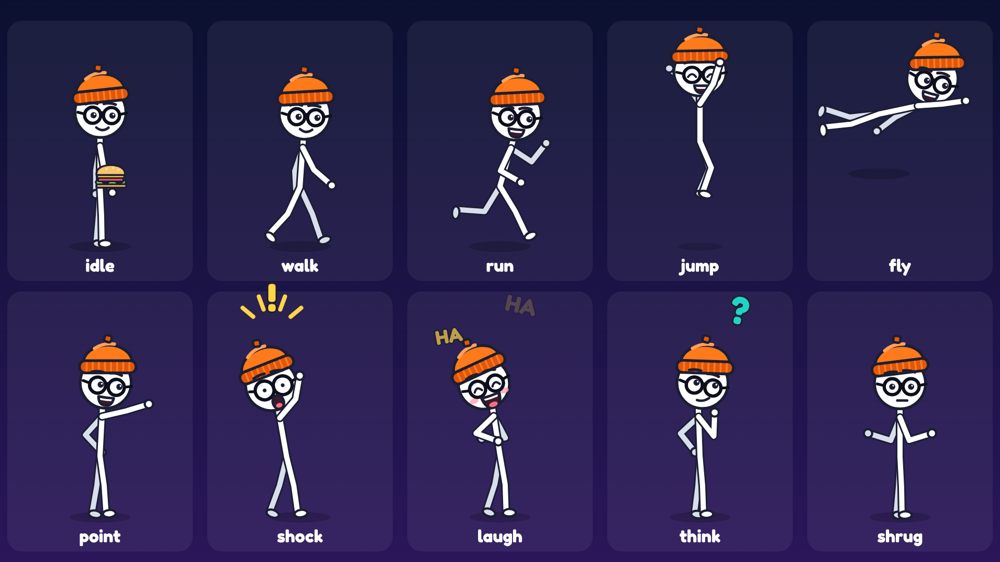

# What If Bix

A code-based video factory for **What If Bix**, a faceless English YouTube channel of animated
*"What if…?"* science stories with humor, for teens and adults.

Every frame and every sound is generated by code:
- **Graphics:** React/SVG, rendered with [Remotion](https://www.remotion.dev).
- **Narration:** offline neural TTS ([Piper](https://github.com/rhasspy/piper)), with optional ElevenLabs or OpenAI voices.
- **Music and sound effects:** synthesized from math.

You write one YAML script per episode. The factory turns it into:

| Output | Spec |
|---|---|
| Long video | 1920×1080, 30 fps, H.264 + AAC, 4–6 min, −14 LUFS. Cold open → 2 s intro sting → story → 20 s end screen |
| 2–3 Shorts | 1080×1920, 35–59 s, standalone hook opener (title on frame 0), re-framed to follow Bix, big captions in the safe zone, animated SUBSCRIBE ending |
| Thumbnail | 1280×720, huge title + Bix with a strong expression |
| Metadata | `metadata.md` / `metadata.json`: title, description with chapters, sources and credits, tags, Shorts titles |
| Captions | `.en.srt` for the long video and every Short |

Episode 1 renders are attached to the pull request in [`docs/episode1/`](docs/episode1). Channel assets are in
[`docs/channel/`](docs/channel). Step-1 style test: [`docs/step1/`](docs/step1).



---

## From script to YouTube in 4 steps

### 1. Write a script

Copy an existing episode and edit it:

```bash
cp episodes/ep01-earth-stops-spinning.yaml episodes/ep06-my-idea.yaml
```

Each scene has narration text, a Bix action, a background with props, on-screen text, timeline chips
("1 second later"…) and cues synced to spoken words (`at: "@brakes"` fires when the narrator says
*brakes*). Every episode lists its `sources`. The full reference, with every background, prop, action and
sound, is **[docs/SCRIPT_FORMAT.md](docs/SCRIPT_FORMAT.md)**.

Check the script (fast, no rendering):

```bash
node pipeline/validate.mjs episodes/ep06-my-idea.yaml   # names, @word cues, chapters, sources, estimated lengths
npm run validate                                        # all episodes, incl. the "too similar to another episode" check
```

Commit and push the script to `main`.

### 2. Run the render workflow

GitHub → **Actions** → **Render episode** → **Run workflow**:

| Input | Value |
|---|---|
| Episode script | `episodes/ep06-my-idea.yaml` |
| What to build | `long,shorts,thumb,meta` (add `frames` for preview stills) |
| Narration voice provider | `piper` (free). `elevenlabs` / `openai` need a secret, see below |
| Channel assets | tick to also render avatar, banner, intro and end screen |

A 5-minute episode takes roughly 30–60 minutes on a standard GitHub runner.

> The workflow appears in the Actions tab once `.github/workflows/render.yml` is on the default branch (`main`).

### 3. Download

Open the finished run and download the artifact named after the episode id. It contains:

```
ep06-my-idea.mp4          long video
ep06-my-idea.en.srt       captions
shorts/<id>.mp4 + .srt    2–3 Shorts
thumbnail.png             1280×720
metadata.md               copy-paste title, description (chapters, sources, credits), tags, Shorts texts
metadata.json             the same data, machine-readable
sources.txt
```

### 4. Upload to YouTube

**Long video** (YouTube Studio → **Create → Upload videos**):
1. Select `<id>.mp4`.
2. **Title:** copy from `metadata.md`. **Description:** copy the whole description block. The chapters inside it turn
   into YouTube chapters automatically.
3. **Thumbnail:** upload `thumbnail.png`.
4. **Audience:** *No, it's not made for kids.*
5. **Show more → Tags:** paste the tags. **Category:** Education. **Language:** English.
   **Captions:** upload `<id>.en.srt`.
6. **Altered content:** *No*. These are obviously stylised cartoons, not realistic people or events.
   Check YouTube's current policy if unsure.
7. **Video elements → End screen:** choose a template with **2 videos + 1 subscribe** and drag the elements onto the
   dashed placeholders in the last 20 seconds.
8. Publish or schedule.

**Shorts** (YouTube app or Studio): upload each `shorts/<id>.mp4`. Use the Short's title and description from
`metadata.md` (they include `#Shorts`). Under **Related video**, link the full episode.

---

## Run locally

Requirements: Node 20+, Python 3.10+, ffmpeg.

```bash
npm ci
pip install -r requirements.txt
bash pipeline/fetch_voice.sh                       # default Piper voice (LibriTTS, CC BY 4.0), ~130 MB

node pipeline/build.mjs episodes/ep01-earth-stops-spinning.yaml          # long + shorts + thumbnail + metadata
node pipeline/build.mjs episodes/ep01-earth-stops-spinning.yaml --only frames   # quick preview stills (1 per scene)
node pipeline/channel.mjs                          # avatar, banner, intro sting, end-screen template -> out/channel
node pipeline/gallery.mjs                          # one still per background/prop group -> out/gallery
npm run studio                                     # live preview in Remotion Studio
npm test && python -m pytest tests/python          # tests
```

Remotion downloads its own headless Chrome on first render. Set `REMOTION_BROWSER=/path/to/chrome` to use another one.
Narration is cached by text + voice, so re-rendering after a visual change skips TTS, and rebuilds are reproducible.

### Optional paid voices

Keys are read from environment variables and are never committed.

| Provider | Secrets / variables (repo → Settings → Secrets and variables → Actions) | Local |
|---|---|---|
| ElevenLabs | secret `ELEVENLABS_API_KEY`, variable `BIX_VOICE_ID` (voice id) | `BIX_TTS_PROVIDER=elevenlabs ELEVENLABS_API_KEY=… BIX_VOICE_ID=… node pipeline/build.mjs …` |
| OpenAI | secret `OPENAI_API_KEY`, optional variable `BIX_VOICE_ID` (e.g. `alloy`) | `BIX_TTS_PROVIDER=openai OPENAI_API_KEY=… node pipeline/build.mjs …` |

ElevenLabs returns exact word timestamps. For Piper and OpenAI, word timing is estimated from phonemes and real pauses
in the audio. Check each provider's terms for commercial YouTube use.

---

## How it works

```
episodes/<id>.yaml
  └─ pipeline/build.mjs
       ├─ pipeline/tts.py            narration per sentence + word timings (Piper / ElevenLabs / OpenAI), cached
       ├─ pipeline/lib/timeline.mjs  scenes on a timeline, "@word" cues → seconds, intro sting + end screen, captions, SFX plan
       ├─ pipeline/audio_assets.py   music (3 styles) + 15 SFX synthesized from oscillators / noise / Karplus-Strong
       ├─ pipeline/mix.py            voice chain, music ducking, SFX placement, loudness −14 LUFS
       ├─ src/ (Remotion)            renders the manifest: long 16:9 and vertical Shorts
       ├─ pipeline/lib/metadata.mjs  chapters, description, tags, SRT, Shorts slices
       └─ ffmpeg                     mux → out/<id>/
```

| Folder | What |
|---|---|
| `src/bix/` | Bix rig: 2-bone limbs, 18 procedural actions (walk, run, jump, fly, point, shock, laugh, think, shrug, wave, tumble, facepalm, sleepy, cheer, float, sit, present, idle) with blending, blinking, emotes, held props. Generic "pal" extras share the rig, without the beanie and glasses |
| `src/scene/` | 10 backgrounds and 40 props (Earth, Moon, Sun, orbits, crowds, charts, clocks, calendars, gauges, phones, Wi-Fi, servers, cables, waves, tides, storms…), camera, transitions, captions, chips |
| `src/compositions/` | Episode (long + Shorts), Thumbnail, channel intro / end screen / avatar / banner, character sheet |
| `pipeline/` | build, validate, channel assets, gallery, TTS, audio, mixing |
| `episodes/` | the scripts (5 episodes) + `samples/` |
| `.github/workflows/` | `ci.yml` (tests, typecheck, script validation, end-to-end smoke render), `render.yml` (on-demand episode render) |

### Keeping every episode unique

YouTube demonetizes "mass-produced or repetitive" content. Every episode uses its own narrative structure:

| # | Episode | Structure |
|---|---|---|
| 1 | Earth stops spinning for 1 second | cause-and-effect chain + "the restart is worse" twist |
| 2 | Never sleep for 30 days | diary / day counter |
| 3 | Everyone on Earth jumps at once | three-scenario experiment |
| 4 | The Internet disappears worldwide | escalating timeline (minute → month) |
| 5 | The Moon is twice as close | "Ask Bix" Q&A on location |

Each episode also has its own scenes, jokes, music seed and outro. `validate.mjs --all` fails if two episodes share
more than 8% of their narration, the same background sequence, or the same outro.

## Licenses

See [CREDITS.md](CREDITS.md). In short: everything visual and every sound is original, generated by this repo. The
default voice is LibriTTS (CC BY 4.0, credited in every description). Fonts are OFL. Remotion is free for individuals
and companies of up to 3 people.
